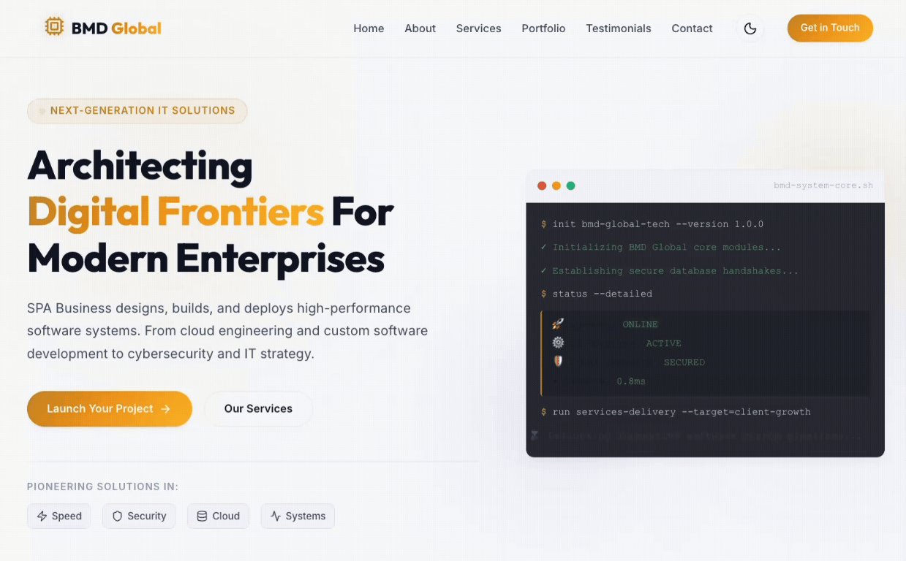

<p align="center">
  
</p>

<h1 align="center">Business Page</h1>

<p align="center">
  A modern digital presence for a technology partner delivering custom software, cloud engineering, cybersecurity, and IT consulting services.
</p>

<p align="center">
  
  
  
  
</p>

<p align="center">
  <a href="#overview">Overview</a>
  ·
  <a href="#getting-started">Getting Started</a>
  ·
  <a href="#customization">Customization</a>
  ·
  <a href="#deployment">Deployment</a>
</p>

<p align="center">
  
</p>

<p align="center">
  
</p>

## Overview

Business Page is a single-page React application built to present the company's capabilities, services, portfolio, client testimonials, and contact options in a polished, responsive interface.

The site includes:

- Responsive navigation with a mobile menu
- Light and dark theme switching with local preference persistence
- Hero section with primary calls to action
- Company overview and values
- Service cards for software, cloud, security, consulting, apps, and data systems
- Portfolio filtering by project category
- Statistics and testimonials sections
- Client-side contact form validation and success state
- Newsletter subscription interaction
- Responsive layouts for desktop, tablet, and mobile screens

## Tech stack

- **React 19** — UI components and application state
- **Vite 8** — development server and production build tooling
- **Lucide React** — interface icons
- **CSS** — custom responsive styling, themes, animations, and layout
- **ESLint** — code-quality checks

## Requirements

- Node.js (an active LTS release)
- npm (or another compatible package manager)

## Getting started

### 1. Install dependencies

```bash
npm install
```

### 2. Start the development server

```bash
npm run dev
```

Vite will print the local URL in the terminal, typically `http://localhost:5173`.

### 3. Create a production build

```bash
npm run build
```

The optimized output is generated in the `dist/` directory.

### 4. Preview the production build locally

```bash
npm run preview
```

## Available scripts

| Command | Description |
| --- | --- |
| `npm run dev` | Start the Vite development server with hot module replacement |
| `npm run build` | Build the application for production |
| `npm run preview` | Serve the production build locally |
| `npm run lint` | Run ESLint across the project |

## Project structure

```text
.
├── public/                  # Static files served from the site root
├── src/
│   ├── assets/              # Images and bundled assets
│   ├── components/          # Page sections and reusable UI components
│   ├── App.jsx              # Main page composition
│   ├── index.css            # Global styles, themes, and responsive rules
│   └── main.jsx             # React entry point
├── index.html               # HTML shell and document metadata
├── eslint.config.js         # ESLint configuration
├── package.json              # Scripts and dependencies
└── vite.config.js            # Vite configuration
```

## Application sections

The page is composed from the following sections:

1. **Hero** — positioning statement and primary calls to action
2. **About** — company story, approach, and values
3. **Services** — available technology services
4. **Stats** — key business metrics
5. **Portfolio** — filterable project showcase
6. **Testimonials** — client feedback
7. **Contact** — contact details and inquiry form
8. **Footer** — navigation, social links, and newsletter signup

## Customization

### Branding and content

Update the relevant component in [`src/components/`](src/components/) to change page copy, service offerings, portfolio entries, testimonials, or contact details.

### Theme and visual design

Global colors, typography, spacing, responsive breakpoints, and light/dark theme variables are defined in [`src/index.css`](src/index.css).

The initial theme is configured in [`index.html`](index.html), while the theme toggle and `localStorage` preference handling live in [`src/components/Navbar.jsx`](src/components/Navbar.jsx).

### Metadata

Update the document title, description, favicon, and font imports in [`index.html`](index.html) when deploying the site under a different brand or domain.

## Current integration notes

- The contact form currently performs validation and displays a simulated success state; it does not send data to a backend.
- The newsletter form currently displays a local subscription confirmation; it does not connect to an email marketing provider.
- Portfolio external-link actions currently point to the contact section and should be replaced with case-study URLs when those are available.
- Social links currently use placeholder platform URLs and should be updated with the organization's official profiles.

## Quality checks

Run the linter before opening a pull request:

```bash
npm run lint
```

For a production-readiness check, build the project after linting:

```bash
npm run build
```

## Deployment

This is a static Vite application and can be deployed to any platform that supports static sites, including Vercel, Netlify, GitHub Pages, or a conventional web server.

Use the following build settings:

| Setting | Value |
| --- | --- |
| Install command | `npm install` |
| Build command | `npm run build` |
| Output directory | `dist` |

If the application is deployed under a subpath rather than the domain root, configure the Vite `base` option in [`vite.config.js`](vite.config.js) before building.

## License

No license has been declared for this project yet. Add a `LICENSE` file and update this section before distributing the source or publishing it as an open-source project.
